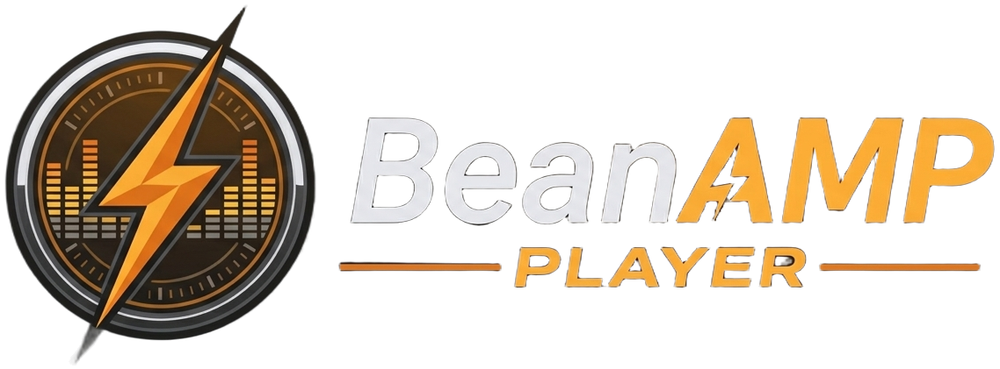
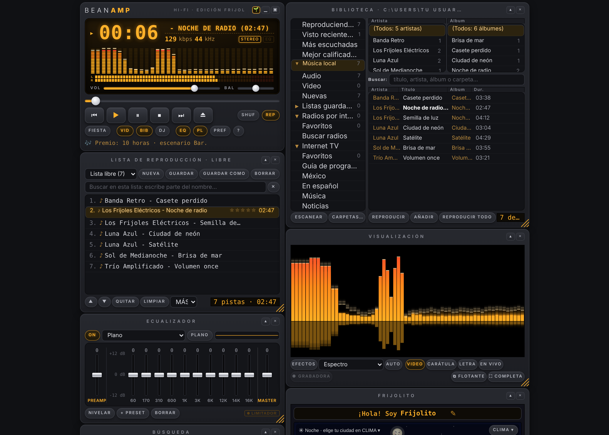
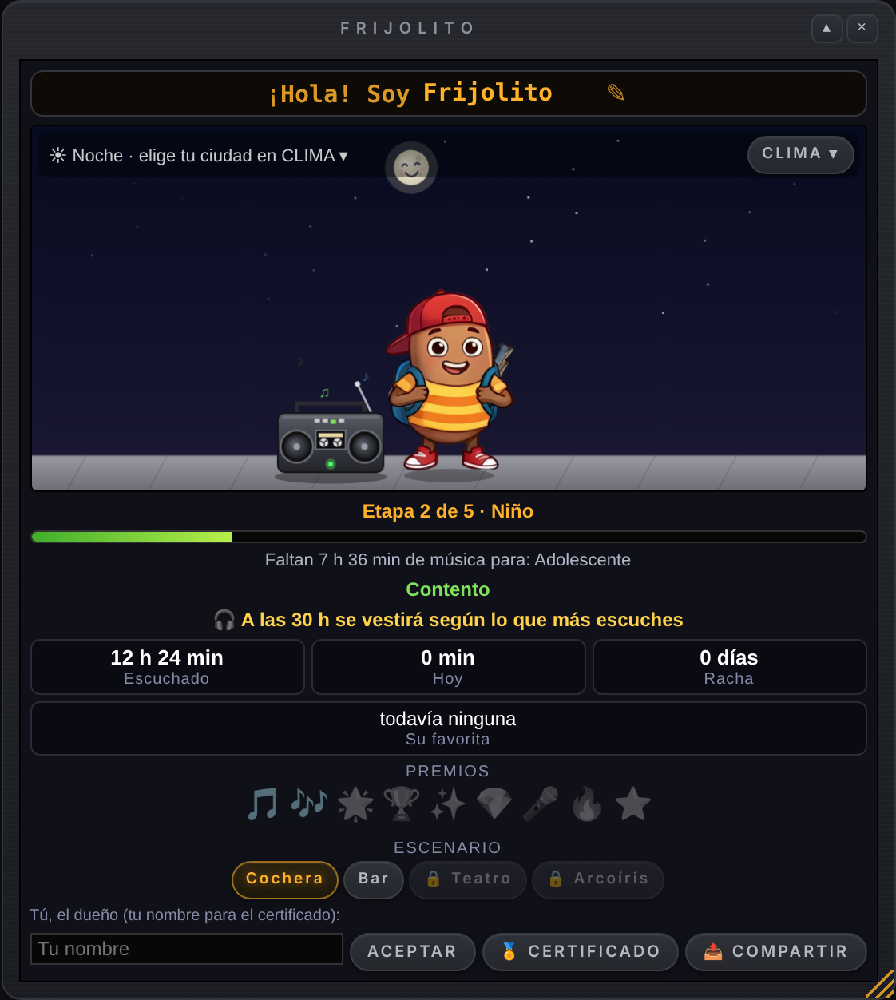
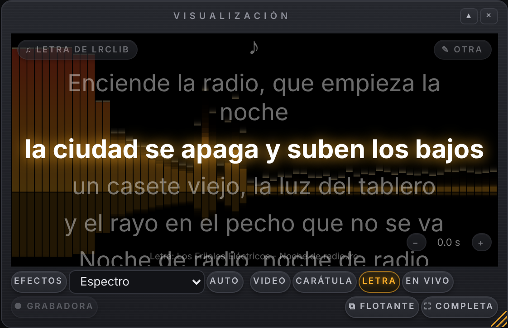
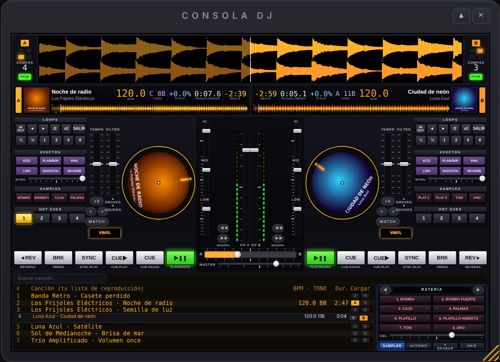

# BeanAMP: reproductor portable para Windows

Reproductor de música, videos y películas con el estilo de los reproductores clásicos de los 2000.
Escucha YouTube, la música y películas de tu PC, radios y TV por internet y tus listas de Spotify.
**Es portable:** no se instala nada. Descomprimes la carpeta (incluso en una USB) y das doble clic en `BeanAMP.exe`.

## Descargar

**[⬇ Descarga la versión más reciente](https://github.com/GarzaBaez/Reproductor-BeanAMP-Public/releases/latest)**

| Archivo | Qué es |
|---|---|
| `BeanAMP_ver2.18_portable.zip` | El programa completo, con el manual. Ya trae yt-dlp, Deno, ffmpeg y 23 skins clásicos: no descarga nada al abrir. |
| `ManualUsuario.pdf` | El manual con imágenes. |

1. Descomprime el zip.
2. Abre la carpeta **BeanAMP** y da doble clic en **BeanAMP.exe**.
3. Si Windows avisa "Windows protegió su PC": *Más información* > *Ejecutar de todas formas*.

Si ya tienes una versión anterior (también WINAMP_Plus 2.17), el programa te avisa cuando hay una nueva y se actualiza solo, sin tocar tus listas, ajustes ni descargas (Preferencias › Actualizaciones).

> Descarga BeanAMP solo de esta página. Otras copias pueden venir cambiadas.

## Qué puede hacer

- Buscar en YouTube y escuchar o ver el video; descargarlo a MP3 o MP4.
- Tu música y tus películas de la PC, con carátulas, etiquetas y subtítulos.
- Biblioteca por artista y álbum, estrellas, Más escuchadas, listas M3U/PLS.
- Radios por internet, Internet TV con listas gratuitas y legales de [iptv-org](https://github.com/iptv-org/iptv), YouTube en vivo y grabadora de TV y radio.
- Letra de la canción sincronizada, como karaoke.
- Ecualizador de 10 bandas con MASTER y limitador, vúmetros, 17 efectos visuales y MilkDrop.
- Modo fiesta: mezcla las canciones como DJ, al azar y sin repetir.
- Consola DJ con dos platos, BPM, sincronía, loops, efectos, automix y grabación de la mezcla.
- **Tu frijol 🌱**: una mascota que crece mientras escuchas música y te da un certificado y tarjetas para compartir.
- Importa tus listas de Spotify.
- Ventanas sueltas con imanes, tema BeanAMP Hi-Fi, otros temas de color y skins clásicos (.wsz).
- Todo lo tuyo queda en la carpeta `media\`: para respaldarlo basta copiarla.

 

## Requisitos

- Windows 10 u 11 (64 bits) con .NET Framework 4.5 o más nuevo (ya viene en Windows).
- Microsoft Edge WebView2 Runtime (ya viene en Windows 11 y en casi todos los Windows 10).

## Créditos

BeanAMP usa [yt-dlp](https://github.com/yt-dlp/yt-dlp), [Deno](https://deno.com), [FFmpeg](https://ffmpeg.org),
[hls.js](https://github.com/video-dev/hls.js), [butterchurn](https://github.com/jberg/butterchurn), Microsoft WebView2,
la fuente [VT323](https://fonts.google.com/specimen/VT323), las listas de [iptv-org](https://github.com/iptv-org/iptv)
y las letras de [LRCLIB](https://lrclib.net). Los detalles y licencias están en el programa, en Preferencias › Acerca de.

---

© 2026 José Alberto Garza. Todos los derechos reservados. Gratis para uso personal.
BeanAMP no tiene relación con Winamp, YouTube, Google, Spotify ni Microsoft; sus marcas son de sus dueños.
